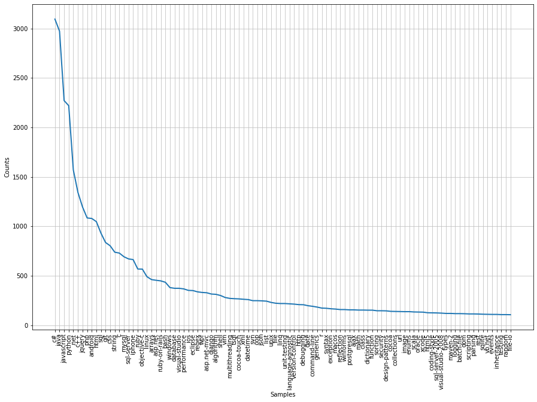

# Predicting Tags from Stack Overflow Using Title Data

My Project 3 at the Metis Data Science Bootcamp (February 2021). The goal was to recommend tags for a Stack Overflow question from its title alone.

## Files

- `Project 3 Notebook.ipynb`: the original 2021 notebook, with example SQL and all of the results.
- `Project 3 Presentation.pdf` (and `.pptx`): slides remade in October 2026, using only the results in the notebook.
- `charts/tag_counts_2021.png`: the tag count chart from the notebook.

## Data

Stack Overflow's public data dump, as the 2010 SQL Server database from [brentozar.com](https://www.brentozar.com/archive/2015/10/how-to-download-the-stack-overflow-database-via-bittorrent/). In SQL Server I removed commas from the titles and tags and the angle brackets around the tags, deleted posts with no title and exported the posts to CSV. Then in pandas:

| Step | Rows |
|---|---:|
| Posts loaded | 1,000,000 |
| Score above 50 | 28,183 |
| More than 10,000 views | 27,666 |
| At least one of the 100 most common tags | 25,352 |

The 27,666 questions had 82,516 tag uses across 6,884 different tags, and I kept the 100 most common. I cleaned the titles (punctuation, verbs to their base form, stop words) and turned them into TF-IDF scores over the 1,000 most frequent words. 20% of the questions (5,071) were held out for testing.

## Models

Each model ran one-vs-rest, so it made 100 yes or no calls for every title. The Jaccard score is out of 100 (higher is better). Hamming loss is the share of the yes or no calls that were wrong.

| Model | Jaccard score | Hamming loss |
|---|---:|---:|
| PassiveAggressive | 48.50 | 1.186% |
| LinearSVC | 47.76 | 1.018% |
| Random forest (three runs) | 45.78 to 45.94 | 1.073 to 1.076% |
| SGD | 45.73 | 1.023% |
| Decision tree | 43.11 | 1.411% |
| Perceptron | 42.68 | 1.699% |
| Logistic regression | 41.09 | 1.093% |
| k-nearest neighbors | 24.22 | 1.424% |
| Multinomial naive Bayes | 23.17 | 1.351% |
| Dummy (random guesses) | 2.57 | 3.141% |

The code labels the three random forests 10, 100 and 1,000 trees, but all three were set to 1,000.

I tuned LinearSVC with a grid search over C (1, 10, 100 and 1,000) and 100-fold cross-validation. The best value was C = 1, the default, so the final scores stayed at 47.76 and 1.018%. Going by the per-tag confusion matrices, the tags it predicted were right 85.5% of the time, and it found 46.0% of the tags the test questions actually had.

## What worked and what didn't

Tags named after a specific tool did best: json 89% recall, git 87%, eclipse 83%, django 80%. Most of the 11 tags that were never predicted correctly are broad topics, such as oop, class, file and math. Three of the six most common tags also scored low, c# at 31%, .net at 25% and c++ at 23%, and c scored 10%.

In 2026 I found part of the reason for the low c#, c++ and c scores. The punctuation cleanup kept a tag name only if it was written in lower case. A title with "C#" or "C++" lost the symbols and became "C", and the TF-IDF settings ignore one-letter words, so for those titles the model never saw the language name.

## What I would change

- Use the question body as well as the title.
- Fix the cleanup above, keep one-letter words such as c, and make stop-word removal ignore case.
- Tune a separate cutoff for each tag, to trade some precision for recall.
- Use newer data. This database ends in 2010, and the score and view filters keep only popular questions.

## Running it

Download the 2010 database from the link above and attach it in SQL Server. The notebook has example SQL for cleaning the posts and exporting them. The CSV it reads (`C:\data_project3\CSVfile.csv`) had the Title, Tags, Score and ViewCount columns for 1,000,000 posts, so change the example SELECT to include Score and ViewCount and that many rows. Then run the notebook from the top. It imports pandas, NumPy, SciPy, NLTK, scikit-learn, matplotlib, seaborn, pyarrow, Dask and Beautiful Soup.

## AI use

The 2021 notebook and its results are my own work. In October 2026 I rewrote this README and remade the slides with AI help, using only the results in the notebook.

Garreth Cline
